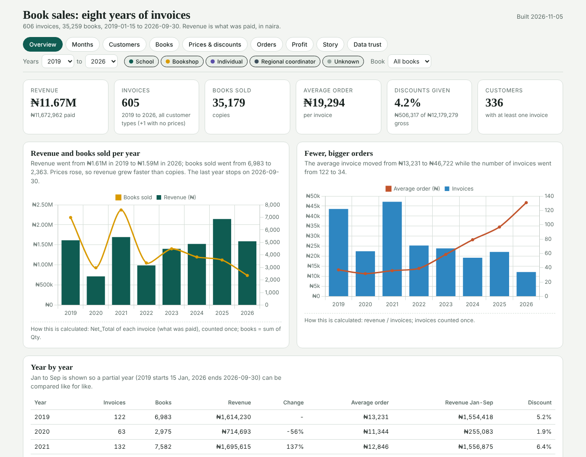
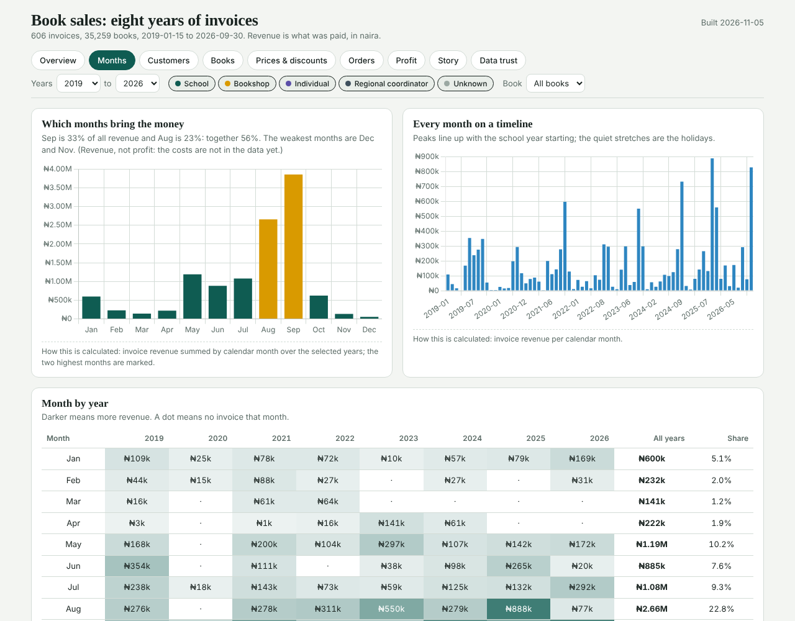

# Eight years of book sales: cleaning and analysing 606 handwritten invoices

A children's book publisher in Lagos kept its sales in handwritten invoice books. This project turns **606 photographed invoices (January 2019 to September 2026)** into a clean, checked dataset and an interactive dashboard, and documents every step so the numbers can be trusted.

| | |
|---|---|
| Invoices | 606 (2,500 book lines, 35,259 copies) |
| Revenue (what was paid) | about ₦11.7 million, nominal naira |
| Customers | 337 (schools, bookshops, individuals) after merging spelling variants |
| Period | 2019-01-15 to 2026-09-30 |
| Checked by the owner | 9.7% of the invoices (47 of 487 for 2019-2026 without 2021), against 71% when 2021 was done entirely by hand |

## Key findings
- **Two months do most of the work.** September is 33% and August 23% of all revenue: the new school year.
- **Fewer, bigger orders.** Invoices fell from 122 (2019) to 34 (2026) while the average invoice grew from ₦13,231 to ₦46,722.
- **Prices did much of the growth.** One typical title went from ₦220 to ₦620 a copy (about 2.8 times); revenue grew faster than copies sold.
- **2020 was the COVID year:** schools closed and revenue fell 56%, then rebounded 137% in 2021.
- **A spread-out customer base.** The ten biggest customers are 26% of revenue; schools bring 76%.
- Revenue is not profit: the cost of the books is not in this dataset (the dashboard has a Profit page that fills in when a cost file is added, see `data/costs/`).




## Open the dashboard
Open `dashboard/index.html` in a browser (one self-contained file, works offline). Tabs: Overview, Months, Customers, Books, Prices & discounts, Orders, Profit, Story, Data trust. With GitHub Pages switched on (Settings > Pages) the repository's own web address opens it on any phone.

## Read the business report
[`docs/BUSINESS_REPORT.md`](docs/BUSINESS_REPORT.md) tells in words and small charts how the business has been going, what to look out for and what to do about it.

## How the data was cleaned (short version)
1. The invoice photos were first read into a spreadsheet by an AI model. Its errors: misread digits and names, and photo links that pointed to the wrong invoice.
2. Every photo was then read again, **blind**, by independent readers who never saw the spreadsheet (two passes, 492 photos).
3. A written set of 32 rules accepted a value only when it agreed with an independent reading, repaired arithmetic that could be proven wrong (quantity x price = line total, lines add up to the total, clean percentage discounts, whole quantities), used the invoice-number series to settle dates, and detected swapped or rotated photo links.
4. What no rule could settle went to the owner, one invoice at a time, with the photo. Every decision is recorded.
5. A final review checked each photo against the data (no photo counted twice, printed number against invoice number, arithmetic, dates against the numbering, price trends). It found and fixed three real errors.

Details: [`docs/methodology.md`](docs/methodology.md), [`docs/data_quality.md`](docs/data_quality.md), [`docs/limitations.md`](docs/limitations.md). Columns: [`data/DATA_DICTIONARY.md`](data/DATA_DICTIONARY.md).

## What is in this repository
```
index.html         opens the dashboard
data/processed/    invoices.csv, lines.csv, customers.csv  (anonymised: Customer_ID instead of names)
data/costs/        where a cost file goes (optional)
docs/              BUSINESS_REPORT.md, methodology, data quality, limitations, how to update
analysis/          build_kpis.py, build_dashboard.py, update_dashboard.py, tables/ (every number behind a chart)
dashboard/         index.html (the dashboard), template and data
reports/           pictures, the project summary, the LinkedIn post draft
tests/             check_data.py (independent checks of the data)
```
The original photos, the raw spreadsheets and the customer names are **not** published: they contain personal and business-confidential details.

## Reproduce
```
pip install -r requirements.txt
python tests/check_data.py            # independent checks of the data
python analysis/update_dashboard.py   # rebuilds the tables and dashboard/index.html
```

## Licence
Code: MIT (`LICENSE`). Data, documents and pictures: CC BY 4.0 (`LICENSE-DATA-AND-TEXT.md`). Built with Claude Code.
