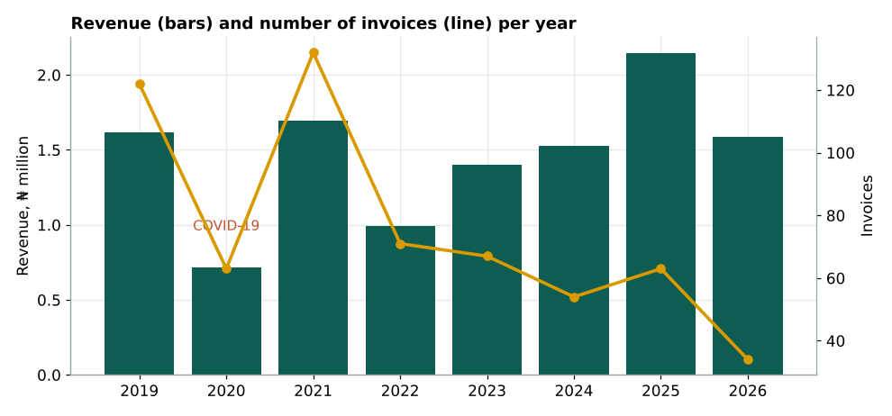
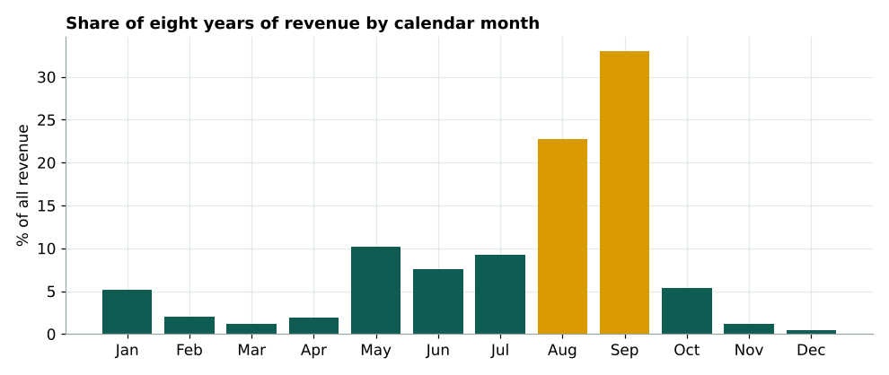
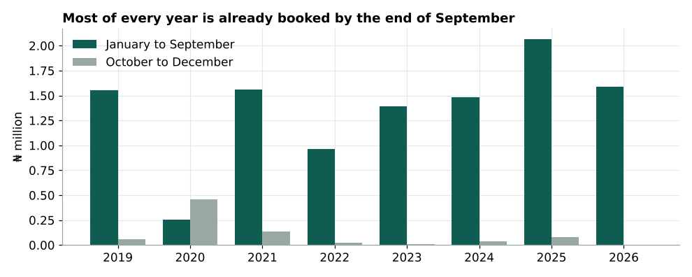
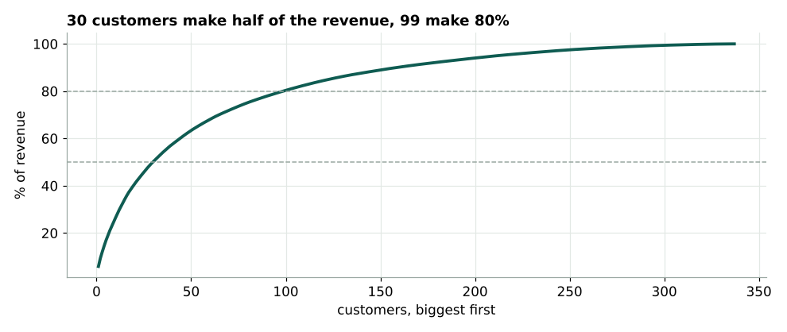
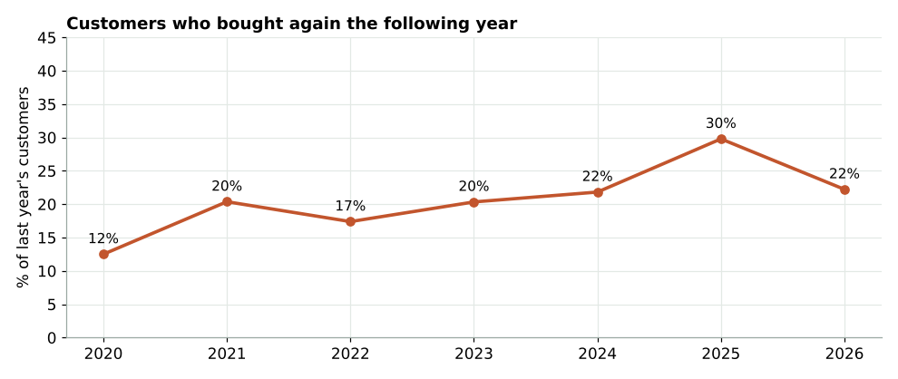
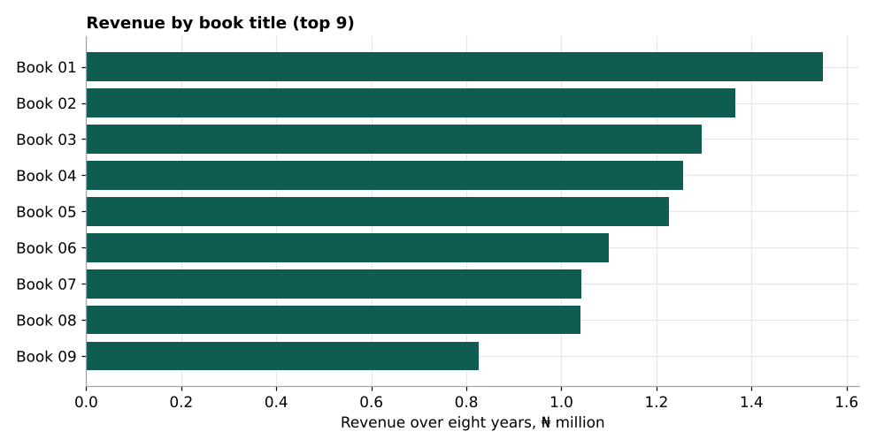
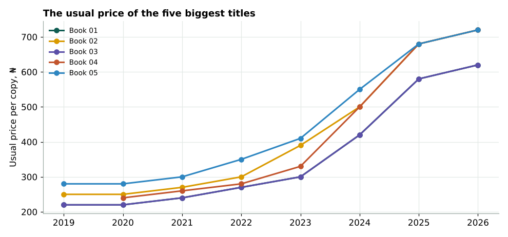
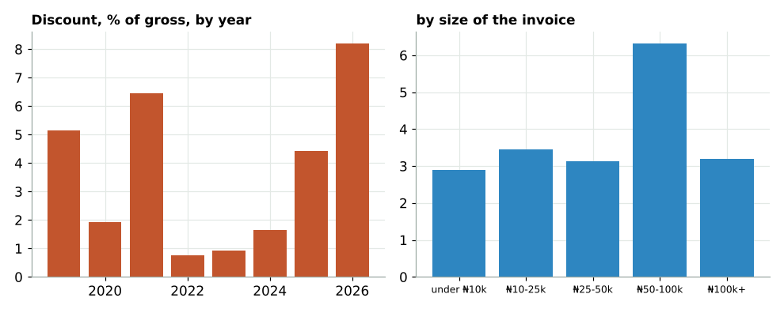
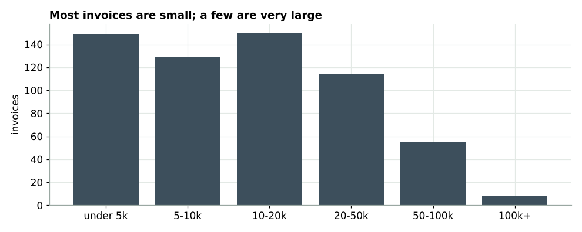

# Business report: eight years of book sales (2019 to 2026)

*A plain-language read of 606 invoices, 2,500 book lines and 35,259 copies sold by a children's book publisher in Lagos. Every figure comes from the cleaned data and is revenue (what was paid), in naira of the day. Profit is not here: the cost of the books is not in the data. Built 2026-11-05.*

## 1. The short version

- **Revenue** over the period: **₦11,672,962**. The best year was **2025** (₦2,144,544).
- **The business lives on the school year.** August and September bring **56%** of all revenue (33% for September alone). December brings 0.5%.
- **Fewer, bigger orders.** Invoices per year fell from 122 (2019) to 63 (2025), while the average invoice grew from ₦13,231 to ₦34,040 (₦46,722 so far in 2026).
- **Prices did much of the growth.** A typical title went from ₦220 to ₦620 a copy (about 16% a year). Copies sold per year fell from 6,983 (2019) to 3,674 (2025).
- **A spread-out customer base, but customers do not come back often.** 30 customers make half of the revenue; only 21% of a year's customers buy again the next year.
- **2020 was the COVID year**: revenue fell 56% when schools closed, then rebounded 137% in 2021.
- **What to watch:** dependence on two months, a small share of returning customers, volume falling while prices rise, and a higher discount rate in 2026 (8.2% against 5.2% in 2019).

## 2. How the business has been going

| Year | Invoices | Books sold | Revenue | Change | Average invoice | Jan-Sep revenue | Discount |
|---|---:|---:|---:|---:|---:|---:|---:|
| 2019 | 122 | 6,983 | ₦1,614,230 |  | ₦13,231 | ₦1,554,418 | 5.2% |
| 2020 | 63 | 2,975 | ₦714,693 | -56% | ₦11,344 | ₦255,083 | 1.9% |
| 2021 | 132 | 7,582 | ₦1,695,615 | +137% | ₦12,846 | ₦1,556,875 | 6.4% |
| 2022 | 71 | 3,362 | ₦989,654 | -42% | ₦13,939 | ₦963,434 | 0.8% |
| 2023 | 67 | 4,486 | ₦1,401,306 | +42% | ₦20,915 | ₦1,391,806 | 0.9% |
| 2024 | 54 | 3,834 | ₦1,524,363 | +9% | ₦28,229 | ₦1,484,973 | 1.6% |
| 2025 | 63 | 3,674 | ₦2,144,544 | +41% | ₦34,040 | ₦2,065,428 | 4.4% |
| 2026 | 34 | 2,363 | ₦1,588,557 | -26% | ₦46,722 | ₦1,588,557 | 8.2% |

**In words.** 2019 was a normal year (₦1,614,230). **2020 fell 56% to ₦714,693** because schools were closed by COVID-19, which is exactly the customer the business sells to. 2021 reopened with a 137% rebound (₦1,695,615), above 2019. 2022 fell back to ₦989,654. From 2023 revenue grew again every year: ₦1,401,306, ₦1,524,363, ₦2,144,544, the highest year. 2026 has nine months of data (₦1,588,557, -23% against January to September 2025).

**Important:** from 2022 on, growth comes from fewer but much larger orders and higher prices, not from more invoices. The number of invoices in 2025 is about half of 2021.

## 3. The seasons: when the money comes

**In words.** September is the biggest month by far (33%), then August (23%): schools buy for the new school year. May to July bring another 27%. November to April together are only 12%. In the years 2022 to 2025 August and September were 61%, 61%, 66%, 67% of the year.

**What it means:** stock has to be ready and the sales effort made in May to July; cash is tight from November to April; a bad August and September cannot be recovered later in the year.

## 4. The customers

- **337 customers** (after merging spelling variants); schools bring 76% of revenue, bookshops 13%, individuals 8%.
- **30 customers make half of the revenue**, 99 make 80%. The ten biggest are 26%. No single customer carries the business: the biggest is 5.9%.
- **256 customers (76%) bought only once**; together they are 36% of revenue. **37 customers bought in three or more different years** and bring 45% of revenue: the loyal core.

**Retention is the weak spot.** Of the customers who bought in a given year, 12% to 30% bought again the next year. Between 30% and 78% of each year's customers (2020 to 2026) were new that year (2023: 33 new of 55, 2024: 24 new of 47, 2025: 28 new of 54, 2026: 9 new of 30).

**The ten biggest customers over the period:**

| Customer | Type | Invoices | Years active | Last invoice | Revenue |
|---|---|---:|---:|---|---:|
| Customer C001 | School | 10 | 8 | 2026-09-21 | ₦683,785 |
| Customer C002 | School | 6 | 5 | 2025-09-26 | ₦396,820 |
| Customer C003 | Bookshop | 9 | 5 | 2025-08-22 | ₦315,110 |
| Customer C004 | School | 15 | 6 | 2026-09-16 | ₦295,309 |
| Customer C005 | Individual | 5 | 1 | 2021-10-16 | ₦277,000 |
| Customer C006 | School | 7 | 7 | 2026-09-21 | ₦241,670 |
| Customer C007 | School | 1 | 1 | 2019-06-15 | ₦240,000 |
| Customer C008 | Regional coordinator | 4 | 1 | 2019-05-22 | ₦212,341 |
| Customer C009 | Individual | 3 | 1 | 2024-09-19 | ₦208,800 |
| Customer C010 | School | 7 | 5 | 2026-09-30 | ₦208,160 |

**Gone quiet (win-back list).** 58 customers bought at least twice and have not bought since 2025-09-30: together ₦4,235,139 of past revenue. The biggest:

| Customer | Type | Invoices | Last invoice | Past revenue |
|---|---|---:|---|---:|
| Customer C002 | School | 6 | 2025-09-26 | ₦396,820 |
| Customer C003 | Bookshop | 9 | 2025-08-22 | ₦315,110 |
| Customer C005 | Individual | 5 | 2021-10-16 | ₦277,000 |
| Customer C008 | Regional coordinator | 4 | 2019-05-22 | ₦212,341 |
| Customer C009 | Individual | 3 | 2024-09-19 | ₦208,800 |
| Customer C012 | School | 6 | 2024-09-20 | ₦197,214 |
| Customer C014 | School | 5 | 2025-08-04 | ₦180,630 |
| Customer C017 | School | 5 | 2025-09-19 | ₦156,030 |
| Customer C018 | School | 5 | 2024-07-12 | ₦137,850 |
| Customer C020 | School | 5 | 2025-08-18 | ₦129,830 |

## 5. The books

**In words.** Book 01 is the biggest title (13% of book revenue); the three biggest together are 36%. Revenue is spread over the whole range: the nine titles shown are 92%.

**What changed.** Comparing 2019-2021 with 2024-2026, the titles gaining share are Book 10 (+6.0 points), Book 04 (+5.9 points), Book 11 (+3.6 points); those losing share are Book 06 (-4.0 points), Book 08 (-3.3 points), Book 03 (-3.1 points).

## 6. Prices and discounts

**Prices.** Each title rises over time, in steps. For the title shown at ₦220 in 2019 and ₦620 in 2026 that is about 16% a year, with a sharper climb from 2024. Part of this may simply follow general inflation (the data holds no inflation figures). Over the same years books sold per year fell, so part of the growth in revenue is price, not volume.

**Discounts.** Overall 4.2% of the gross value was given away. The rate moved between 0.8% and 8.2% by year and was highest in 2026 (8.2%). By customer type: Bookshop 3.7%, Individual 8.9%, School 3.8%.

**Bookshops against schools** (median price paid for the same title):

| Title | Schools | Bookshops | Difference |
|---|---:|---:|---:|
| Book 01 | ₦250 | ₦230 | -8% |
| Book 02 | ₦270 | ₦280 | +4% |
| Book 03 | ₦240 | ₦230 | -4% |
| Book 04 | ₦300 | ₦250 | -17% |
| Book 05 | ₦350 | ₦288 | -18% |
| Book 06 | ₦400 | ₦296 | -26% |

## 7. The orders

The **middle invoice is ₦10,820**, the average ₦19,262: a few large orders pull the average up. 8 invoices of ₦100,000 or more (1.3% of invoices) bring 11% of revenue, and the five largest invoices alone are 8%.

## 8. What to look out for

- **Two months decide the year.** August and September are 56% of revenue. A delay in printing, a late delivery or a school-fee problem in those weeks is not recoverable.
- **Customers do not come back.** Only about 21% of a year's customers buy again the next year, so the business has to win a large number of new customers every year.
- **Volume is falling while prices rise.** Copies sold per year: 6,983 (2019), 3,362 (2022), 3,674 (2025). Revenue grows because each copy costs more. Watch whether higher prices are losing small buyers.
- **Dependence on large orders.** 8 large invoices bring 11% of revenue. Losing a few of them changes the year.
- **Discount creep.** The discount rate was 5.2% in 2019 and 8.2% in 2026. Check whether the larger discounts bring larger orders.
- **Quiet customers.** 58 repeat customers have gone quiet; they were worth ₦4,235,139.
- **Margin is unknown.** Without the cost of producing each title nothing can be said about profit, the best month for profit, or which customers are really worth most.
- **Titles that fade.** Book 12 not sold since 2023-09-12; Book 08, Book 06 lost the most share. Check whether stock is tied up in them.

## 9. What to do with this (suggestions, to be judged by the owner)

- **Plan the year backwards from September:** printing and stock decisions by May, a sales push to schools in May to July.
- **Call the win-back list** (section 4) before the next May.
- **Build a simple yearly customer record** (first order, last order, total) so retention can be tracked monthly.
- **Review the discount policy** against order size: give larger discounts only for larger orders.
- **Test prices carefully:** the steps of the last years were large; compare the small buyers before and after each step.
- **Collect the cost per copy for each title and year:** the dashboard then shows margin, the most profitable month and the most profitable customers (the Profit tab fills in by itself).
- **Keep recording invoices in the same way:** the data pipeline and dashboard rebuild in minutes.

## 10. About the data (read before quoting a number)

- 606 invoices from handwritten invoice books, read from photographs, cross-checked by independent readings and 32 written rules, and a final review. The owner checked 9.7% of the invoices (47 of 487 for 2019-2026 without 2021).
- Revenue is what was paid; all invoices are assumed paid; returns and refunds written on a few papers are not recorded.
- Only photographed papers are in the data: some invoice numbers are missing in every year.
- 16 invoices have lines that do not add up to the total written on the paper (the shop's own arithmetic); they are kept as written.
- 2019 starts on 2019-01-15; 2026 stops on 2026-09-30, so 2026 is a part year.
- Customer types are decided from the names; a few are a guess.
- Naira amounts are of the day, not adjusted for inflation.
